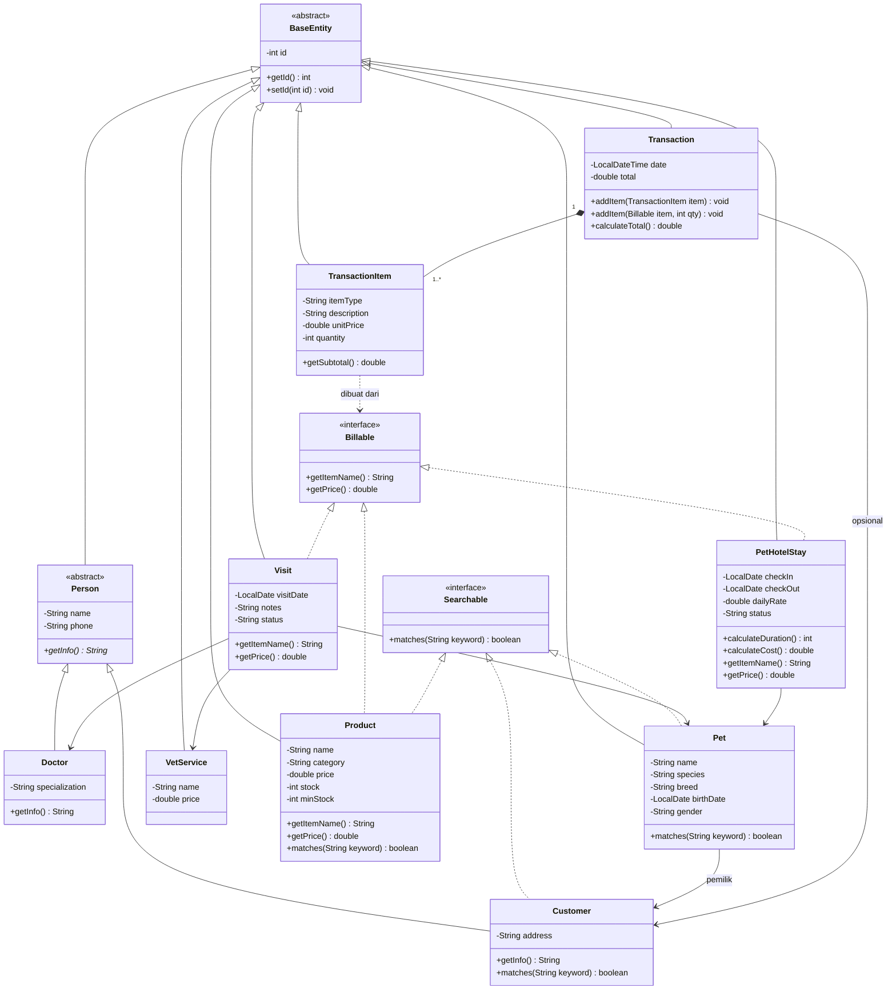
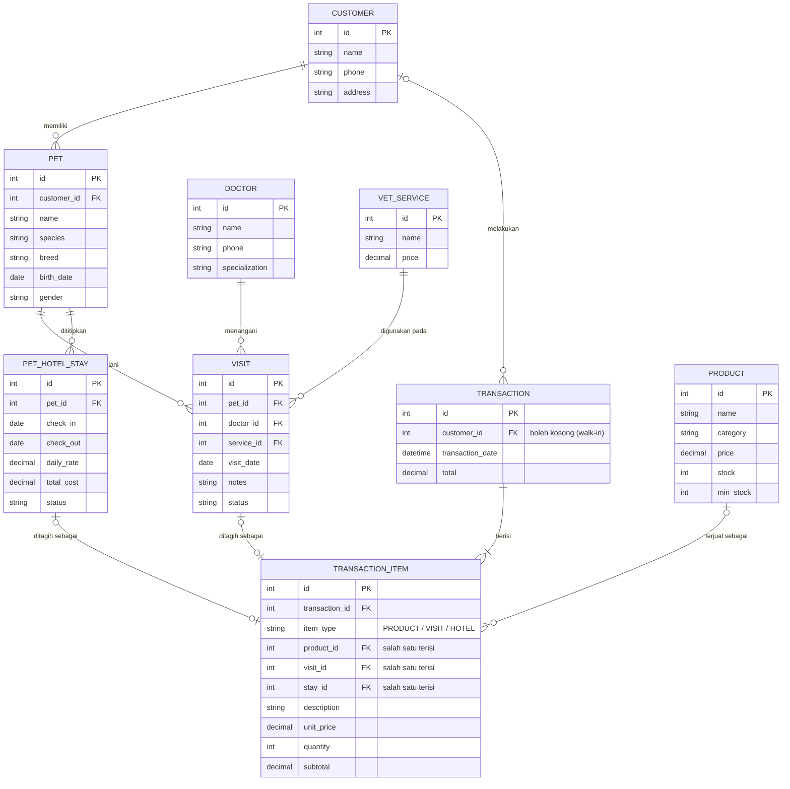

# Jojoba Pet Center Management System

**An Integrated Management System for Pet Care and Retail Business**

## 1. Project Overview

Jojoba Pet Center Management System merupakan aplikasi desktop berbasis Java Swing yang ditujukan untuk membantu pengelolaan operasional Jojoba Pet Center Jatinangor.

Jojoba Pet Center merupakan usaha yang bergerak di bidang layanan dan kebutuhan hewan peliharaan, meliputi pengobatan, vaksinasi, sterilisasi, perawatan, vitamin, rawat inap (pet hotel), serta penjualan produk hewan.

Proyek ini mengintegrasikan aktivitas layanan hewan peliharaan dan penjualan produk dalam satu aplikasi, sehingga data pelanggan, hewan peliharaan, layanan, dan transaksi dapat dikelola secara terstruktur.

## 2. Background

Usaha pet center memiliki karakteristik operasional yang berbeda dari toko retail biasa. Selain menjual produk, pet center juga menyediakan layanan yang membutuhkan pencatatan pelanggan, identitas hewan, riwayat kunjungan, dan administrasi layanan.

Pencatatan yang belum terintegrasi dapat menyulitkan pengelolaan operasional. Oleh karena itu, dirancang aplikasi desktop yang membantu pengelolaan data dan aktivitas pet center dalam satu tempat.

## 3. Project Objectives

- Mengintegrasikan pengelolaan layanan pet care dan penjualan produk.
- Mempermudah pencatatan data pelanggan dan hewan peliharaan.
- Membantu pengelolaan kunjungan klinik dan penitipan hewan.
- Mengelola data produk, stok, dan transaksi.
- Menyediakan informasi operasional melalui dashboard dan laporan sederhana.

## 4. Application Menu

Aplikasi dibuat untuk sisi **Admin** (pengelola toko). Karena fokus pada administrasi operasional, aplikasi **tidak memiliki sistem login/autentikasi**.

| No | Menu | Deskripsi | Input | Proses | Output |
| -- | ---- | --------- | ----- | ------ | ------ |
| 1 | Dashboard | Ringkasan kondisi operasional toko. | - (otomatis saat dibuka) | Menghitung data customer, hewan, kunjungan, penitipan aktif, transaksi, dan produk yang stoknya menipis. | Kartu ringkasan angka. |
| 2 | Customer Management | Mengelola data pemilik hewan. | Nama, telepon, alamat; kata kunci pencarian. | Menambah, mengubah, menghapus, dan mencari customer. | Tabel customer. |
| 3 | Pet Management | Mengelola identitas hewan. | Nama, jenis, ras, tanggal lahir, jenis kelamin, pemilik. | Menyimpan data hewan dan menghubungkannya dengan customer. | Tabel hewan beserta pemiliknya. |
| 4 | Veterinary Services | Mengelola daftar layanan klinik. | Nama layanan (pengobatan, vaksinasi, sterilisasi, vitamin), harga. | Menambah, mengubah, dan menghapus layanan. | Daftar layanan dan harga. |
| 5 | Visit Management | Mencatat kunjungan hewan ke klinik. | Hewan (customer mengikuti data hewan), dokter, layanan, tanggal, catatan tindakan. | Menyimpan kunjungan dan memperbarui status kunjungan. | Riwayat kunjungan beserta status. |
| 6 | Pet Hotel Management | Mengelola penitipan hewan. | Hewan, tanggal check-in, tanggal check-out, tarif per hari. | Menghitung durasi (hari) dan biaya (durasi x tarif), serta memperbarui status saat check-out. | Daftar penitipan beserta biaya dan status. |
| 7 | Product & Inventory | Mengelola produk pet shop dan stoknya. | Nama, kategori, harga, stok, stok minimum; kata kunci/filter. | Menambah, mengubah, menghapus, mencari produk, dan menandai stok menipis. | Katalog produk beserta stok. |
| 8 | Transaction Management | Memproses pembayaran produk, layanan, dan penitipan dalam satu alur. | Customer (opsional), item (produk, kunjungan, atau penitipan), jumlah. | Menambah item ke transaksi, menghitung subtotal dan total, menyimpan transaksi, dan mengurangi stok produk. | Ringkasan transaksi dan riwayat transaksi. |
| 9 | Reports | Menampilkan laporan operasional. | Jenis laporan dan periode tanggal. | Merekap data transaksi, layanan, kunjungan, dan stok. | Tabel laporan. |

## 5. Technology Stack

| Technology   | Usage                             |
| ------------ | --------------------------------- |
| Java         | Main programming language         |
| Java Swing   | Desktop GUI development           |
| MySQL        | Relational database               |
| JDBC         | Database connectivity             |
| Git & GitHub | Version control and collaboration |

## 6. Project Structure

Struktur mengikuti pola pada latihan sistem kasir (`entity`, `model`, `repository`, `view`).

```
JojobaPetCenter/
├── entity/
│   ├── BaseEntity.java          (abstract)
│   ├── Person.java              (abstract)
│   ├── Customer.java
│   ├── Doctor.java
│   ├── Pet.java
│   ├── VetService.java
│   ├── Visit.java
│   ├── PetHotelStay.java
│   ├── Product.java
│   ├── Transaction.java
│   ├── TransactionItem.java
│   ├── Billable.java            (interface)
│   └── Searchable.java          (interface)
├── model/
│   ├── TransactionModel.java    (keranjang transaksi, hitung total)
│   ├── DashboardModel.java
│   └── ReportModel.java
├── repository/
│   ├── DatabaseUtil.java        (koneksi JDBC)
│   ├── CrudRepository.java      (interface)
│   ├── CustomerRepository.java
│   ├── PetRepository.java
│   ├── DoctorRepository.java
│   ├── VetServiceRepository.java
│   ├── VisitRepository.java
│   ├── PetHotelRepository.java
│   ├── ProductRepository.java
│   └── TransactionRepository.java
├── view/
│   ├── MainFrame.java           (menu navigasi + area konten)
│   ├── DashboardPanel.java
│   ├── CustomerPanel.java
│   ├── PetPanel.java
│   ├── VetServicePanel.java
│   ├── VisitPanel.java
│   ├── PetHotelPanel.java
│   ├── ProductPanel.java
│   ├── TransactionPanel.java
│   └── ReportPanel.java
├── Main.java
└── resources/
    └── script.sql               (struktur tabel + data awal)
```

Setiap menu ditampilkan sebagai satu panel di dalam `MainFrame` agar navigasi tetap sederhana. Data dokter tidak memiliki menu tersendiri karena jumlah dokter di toko masih sedikit; datanya disiapkan di `script.sql` dan dipilih lewat dropdown pada menu Visit.

## 7. Object-Oriented Programming Implementation

| Konsep | Penerapan |
| ------ | --------- |
| **Encapsulation** | Atribut pada semua class entity bersifat `private` dan diakses melalui getter/setter. |
| **Inheritance** | `BaseEntity` → `Person` → `Customer` dan `Doctor`; class entity lain juga mewarisi `BaseEntity`. |
| **Polymorphism** | `getInfo()` pada `Person` dan turunannya berperilaku berbeda; transaksi memproses `Billable` (produk, kunjungan, penitipan) dengan cara yang sama. |
| **Abstraction** | `BaseEntity` dan `Person` sebagai abstract class; `Billable`, `Searchable`, dan `CrudRepository<T>` sebagai interface. |

### Abstract Class & Interface

- **Abstract class:**
  - `BaseEntity` : atribut `id` yang dimiliki semua entity.
  - `Person` : nama, nomor telepon, dan abstract method `getInfo()`.
- **Interface:**
  - `Billable` : item yang dapat ditagih (`getItemName()`, `getPrice()`), diimplementasikan oleh `Product`, `Visit`, dan `PetHotelStay`.
  - `Searchable` : objek yang dapat dicari (`matches(String keyword)`), diimplementasikan oleh `Customer`, `Pet`, dan `Product`.
  - `CrudRepository<T>` : kontrak operasi dasar database (`findAll`, `findById`, `save`, `update`, `delete`), diimplementasikan oleh semua repository.

### Bentuk Inheritance

- **Hierarchical:** `Person` memiliki dua turunan, yaitu `Customer` dan `Doctor`.
- **Multilevel:** `BaseEntity` → `Person` → `Customer` (tiga tingkat).
- **Multiple (melalui interface):** Java tidak mendukung multiple inheritance antar class, sehingga diterapkan melalui interface. Contohnya `Product` yang meng-implement `Billable` dan `Searchable` sekaligus.

### Override & Overload

- **Override:** `getInfo()` pada `Customer` dan `Doctor`, `toString()` pada entity, serta `getItemName()` dan `getPrice()` pada implementasi `Billable`.
- **Overload:**
  - `Transaction.addItem(TransactionItem item)` dan `addItem(Billable item, int qty)`.
  - `ProductRepository.search(String keyword)` dan `search(String keyword, String category)`.
  - Constructor dengan parameter berbeda (dengan/tanpa `id`).

## 8. Class Diagram

Diagram berikut menunjukkan hubungan inheritance (hierarchical, multilevel, dan multiple melalui interface) serta relasi antar entity.



## 9. Database Design (ERD)

Database MySQL diakses melalui JDBC (`DatabaseUtil`). Struktur tabel dan data awal (dokter dan layanan klinik) tersedia di `resources/script.sql`.



Catatan desain:

- Customer pada kunjungan diperoleh dari hewan (`visit.pet_id` → `pet.customer_id`), sehingga tidak disimpan ulang di tabel `visit`.
- `transaction_item` menyimpan harga satuan saat transaksi (`unit_price`) agar riwayat tidak berubah ketika harga produk atau layanan diperbarui.
- Pada `transaction_item`, kolom `product_id`, `visit_id`, atau `stay_id` hanya salah satu yang terisi, sesuai `item_type`.

## 10. Project Scope & Limitations

Untuk menjaga proyek tetap realistis dalam lingkup aplikasi GUI berbasis Java Swing, sistem memiliki beberapa batasan:

- Sistem difokuskan pada administrasi operasional pet center dari sisi admin, tanpa login.
- Pengelolaan klinik dibatasi pada pencatatan kunjungan dan tindakan dokter, bukan sistem diagnosis atau pengambilan keputusan medis.
- Pengelolaan pet hotel dibatasi pada administrasi penitipan dan perhitungan biaya.
- Penjualan produk difokuskan pada transaksi dan pengelolaan stok.
- Sistem tidak mencakup machine learning, artificial intelligence, maupun integrasi pembayaran eksternal.

Fitur akhir akan disesuaikan dengan hasil observasi dan kebutuhan aktual Jojoba Pet Center.

## 11. Project Status

**Status: Design & Requirement Analysis**

Ruang lingkup sistem, struktur menu, class diagram, dan ERD sudah ditetapkan. Tahap berikutnya: penulisan `script.sql`, desain antarmuka, lalu implementasi fitur.

---