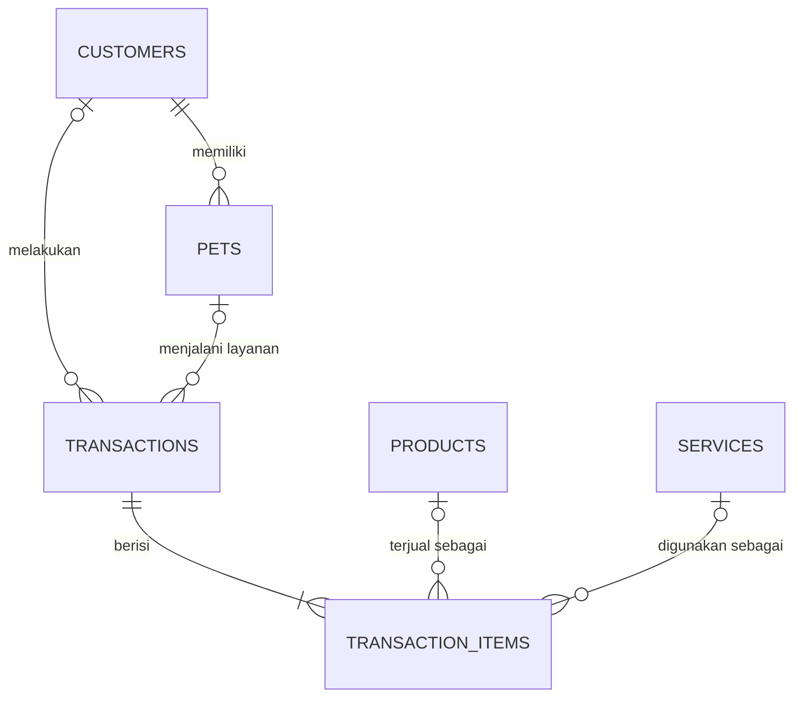

# Jojoba Pet Center Management System

Aplikasi desktop berbasis **Java Swing** untuk membantu administrasi operasional **Jojoba Pet Center Jatinangor**, yaitu layanan hewan peliharaan (pengobatan, vaksinasi, sterilisasi, perawatan, vitamin, penitipan) dan penjualan produk hewan dalam satu aplikasi.

## Latar Belakang

Pet center berbeda dari toko retail biasa. Selain menjual produk, pet center juga memberikan layanan yang perlu dicatat: siapa pemiliknya, hewan yang mana, layanan apa, dan berapa biayanya. Pencatatan yang terpisah-pisah menyulitkan pengelolaan. Aplikasi ini menyatukan data customer, hewan, produk, layanan, dan transaksi di satu tempat.

Aplikasi dirancang untuk sisi **admin** dan sengaja disederhanakan dari kondisi usaha aslinya, sehingga tidak memiliki sistem login.

## Fitur Utama

Aplikasi memiliki **5 menu** dalam satu jendela (navbar di kiri, konten di kanan):

| Menu | Fungsi |
| ---- | ------ |
| **Dashboard** | Ringkasan operasional: jumlah customer, hewan, produk, stok menipis, serta transaksi dan pendapatan hari ini. |
| **Customer & Hewan** | Kelola data pemilik beserta hewan peliharaannya. Memilih customer menampilkan hewan miliknya. |
| **Produk & Stok** | Kelola katalog produk, pencarian, filter kategori, dan penanda stok menipis. |
| **Layanan** | Kelola daftar layanan beserta harga dan satuannya (kali atau hari). |
| **Transaksi** | **Kasir** untuk menjual produk dan layanan dalam satu keranjang, dan **Riwayat** untuk melihat transaksi per periode. |

Beberapa keputusan desain:

- Kunjungan klinik dan penitipan hewan dicatat sebagai **layanan di dalam transaksi**, bukan modul terpisah.
- Transaksi boleh tanpa customer (pembeli umum), dan stok produk berkurang otomatis saat transaksi disimpan.

## Teknologi

| Teknologi | Kegunaan |
| --------- | -------- |
| Java | Bahasa utama |
| Java Swing | Antarmuka desktop |
| MySQL | Database relasional |
| JDBC | Koneksi aplikasi ke database |
| Git & GitHub | Version control dan kolaborasi |

## Arsitektur

Mengikuti pola praktikum: **entity, model, repository, view**.

| Package | Peran |
| ------- | ----- |
| `entity` | Representasi satu baris tabel beserta logika objek sederhana. |
| `model` | Bentuk data siap tampil di tabel GUI (hasil `JOIN` atau agregat). |
| `repository` | Satu-satunya tempat query SQL dan JDBC. |
| `view` | Panel dan frame Swing: menampilkan data dan menangkap input. |

```
MySQL → Repository → Entity / Model → View
```

### Struktur Project

```
src/projek/jojobapetcentermanagementsystem/
├── entity/        BaseEntity, Billable, Searchable, Customer, Pet,
│                  Item, Product, Service, Transaction, TransactionItem
├── model/         PetModel, TransactionModel, DashboardModel
├── repository/    DatabaseUtil, CrudRepository, dan repository tiap entity
└── view/          MainFrame, Refreshable, dan panel tiap menu
resources/script.sql   (struktur tabel + data awal)
```

## Database

Terdiri dari **6 tabel**.



Harga dan nama item disimpan ulang di rincian transaksi, sehingga riwayat tidak berubah ketika harga produk atau layanan diperbarui.

## Penerapan OOP

| Konsep | Penerapan |
| ------ | --------- |
| **Encapsulation** | Atribut entity dan model bersifat `private`, diakses lewat getter/setter. |
| **Abstraction** | Abstract class `BaseEntity` dan `Item`; interface `Billable`, `Searchable`, `CrudRepository<T>`, `Refreshable`. |
| **Inheritance** | *Multilevel:* `BaseEntity` → `Item` → `Product`. *Hierarchical:* `Item` punya turunan `Product` dan `Service`. *Multiple (via interface):* `Product` mengimplementasikan `Billable` dan `Searchable`. |
| **Polymorphism** | `getInfo()` berbeda di `Product` dan `Service`; keranjang memproses `Billable` secara seragam; `MainFrame` memanggil `refresh()` semua panel lewat `Refreshable`. |
| **Override** | `getInfo()`, `getItemName()`, `getItemType()`, `matches()`, `toString()`. |
| **Overload** | `Transaction.addItem(...)`, `ProductRepository.search(...)`, constructor dengan dan tanpa `id`. |

## Pembagian Tugas

Tim terdiri dari 3 orang. Transaksi dipegang satu orang karena bagian paling kompleks, sedangkan setup dan fondasi dikerjakan lebih dulu agar yang lain bisa berjalan paralel.

| | Rakhi Nathan Bertantra | Daniel Chang | Raffi Fauzan |
| --- | --- | --- | --- |
| **Entity** | `BaseEntity`, `Billable`, `Searchable`, `Customer`, `Pet` | `Item`, `Product`, `Service` | `Transaction`, `TransactionItem` |
| **Model** | `PetModel`, `DashboardModel` | - | `TransactionModel` |
| **Repository** | `CrudRepository`, `CustomerRepository`, `PetRepository`, `DashboardRepository` | `ProductRepository`, `ServiceRepository` | `TransactionRepository` |
| **View** | `Refreshable`, `CustomerPetPanel`, `DashboardPanel` | `MainFrame`, `ProductPanel`, `ServicePanel` | `TransactionPanel` (Kasir + Riwayat) |
| **Fokus** | Fondasi, menu Customer & Hewan, Dashboard | Produk, Layanan, navigasi utama | Transaksi (Kasir + Riwayat) |

### Alur Pengerjaan

1. **Fondasi:** setup repo, database, dan class dasar.
2. **Paralel:** masing-masing mengerjakan entity, model, dan repository miliknya.
3. **Panel:** masing-masing membangun panel menunya.
4. **Integrasi:** `MainFrame` memasang semua panel, lalu uji alur penuh dari input data sampai transaksi, stok, dan Dashboard.

### Aturan Kerja

- `main` harus selalu bisa dikompilasi; perubahan masuk lewat Pull Request dari branch `feat/...`, `fix/...`, atau `docs/...`.
- Setiap file punya satu pemilik. Butuh perubahan di file milik orang lain, minta ke pemiliknya.
- Signature method antar bagian adalah kesepakatan bersama; perubahan harus diinformasikan ke tim.

## Cakupan

- Fokus pada administrasi operasional dari sisi admin, tanpa login.
- Tidak mencakup diagnosis medis, jadwal kunjungan, pembayaran eksternal, maupun machine learning atau AI.

## Status

**Design & Requirement Analysis selesai.** Project NetBeans sudah dibuat; tahap berikutnya adalah pembuatan fondasi (database dan class dasar), lalu pengerjaan paralel tiap anggota.