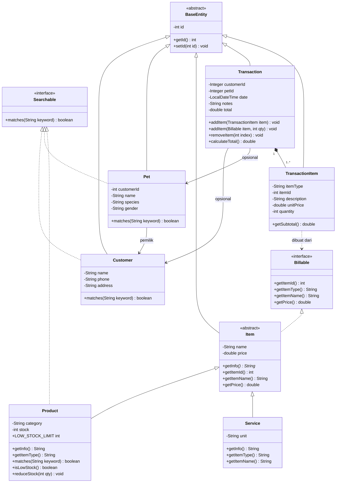
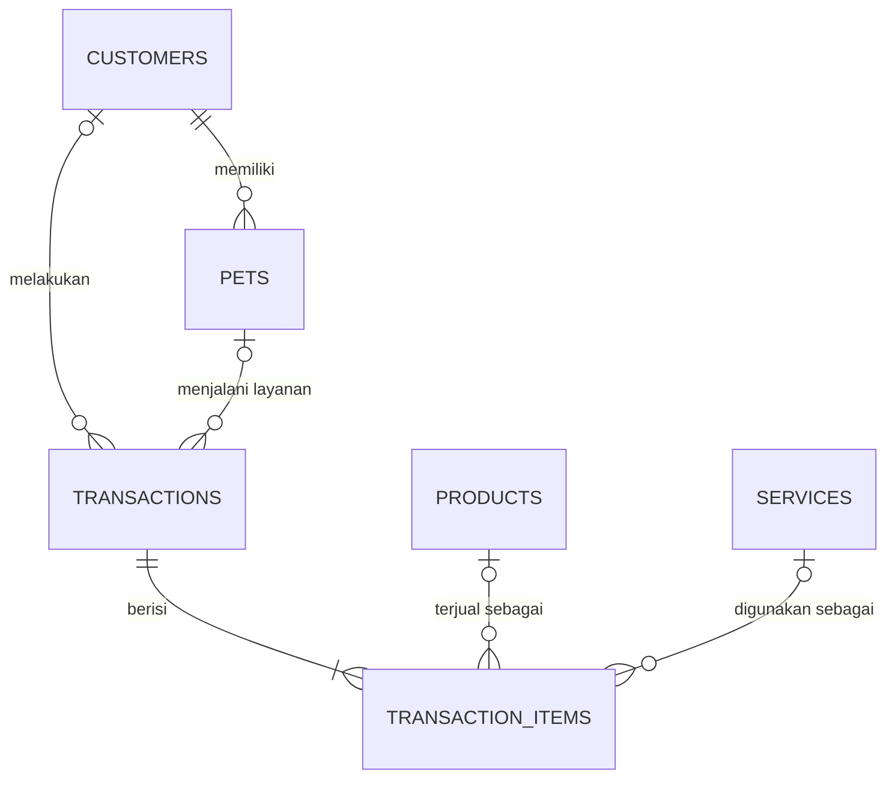

# Jojoba Pet Center Management System

> **Proyek Kelompok Mata Kuliah Pemrograman Berorientasi Objek (PBO)**

## Identitas Tim

| Nama | NPM | Peran Utama |
| ---- | --- | ----------- |
| **Rakhi Nathan Bertantra** | **140810250060** | Fondasi, menu Customer & Hewan, Dashboard |
| **Daniel Chang** | **140810250045** | Produk, Layanan, navigasi utama (`MainFrame`) |
| **Raffi Fauzan** | **140810250067** | Transaksi (Kasir + Riwayat) |

---

Aplikasi desktop berbasis **Java Swing** untuk membantu administrasi operasional **Jojoba Pet Center Jatinangor**, yaitu layanan hewan peliharaan (pengobatan, vaksinasi, sterilisasi, perawatan, vitamin, penitipan) dan penjualan produk hewan dalam satu aplikasi.

## Latar Belakang

Pet center berbeda dari toko retail biasa. Selain menjual produk, pet center juga memberikan layanan yang perlu dicatat: siapa pemiliknya, hewan yang mana, layanan apa, dan berapa biayanya. Pencatatan yang terpisah-pisah menyulitkan pengelolaan. Aplikasi ini menyatukan data customer, hewan, produk, layanan, dan transaksi di satu tempat.

Aplikasi dirancang untuk sisi **admin** dan sengaja disederhanakan dari kondisi usaha aslinya, sehingga tidak memiliki sistem login.

## Fitur Utama

Aplikasi memiliki **5 menu** dalam satu jendela (`MainFrame`): navbar di kiri berisi lima tombol menu, dan area konten di kanan menampilkan panel menu yang dipilih. Setiap kali sebuah menu dibuka, datanya dimuat ulang dari database sehingga tampilan selalu terbaru.

### 1. Dashboard

Halaman ringkasan yang tampil pertama kali saat aplikasi dibuka, untuk memberi gambaran kondisi usaha tanpa perlu membuka menu lain.

- **Kartu ringkasan:** jumlah customer, jumlah hewan, jumlah produk, jumlah produk dengan stok menipis, jumlah transaksi hari ini, dan total pendapatan hari ini.
- **Tabel stok menipis:** daftar produk yang stoknya di bawah batas (`Product.LOW_STOCK_LIMIT` = 5), supaya admin tahu produk apa yang perlu segera diisi ulang.
- **Tanpa input:** semua angka dihitung otomatis dari database lewat query agregat, dan diperbarui setiap kali menu Dashboard dipilih lagi.

### 2. Customer & Hewan

Mengelola pemilik beserta hewan peliharaannya dalam satu layar, karena keduanya selalu berkaitan.

- **Tabel atas, data customer:** tambah, ubah, dan hapus customer (nama, telepon, alamat), serta cari customer berdasarkan kata kunci.
- **Tabel bawah, hewan milik customer terpilih:** saat satu customer dipilih, hewan miliknya langsung tampil di tabel bawah. Dari sana admin dapat menambah, mengubah, dan menghapus hewan (nama, jenis, jenis kelamin).
- **Validasi:** nama dan telepon customer wajib diisi; nama, jenis, dan jenis kelamin hewan wajib diisi. Hewan hanya bisa ditambahkan bila sudah ada customer yang dipilih.
- **Perlindungan data:** customer yang masih punya hewan atau transaksi, dan hewan yang sudah muncul di transaksi, tidak bisa dihapus. Aplikasi menampilkan pesan yang jelas, bukan error.

### 3. Produk & Stok

Mengelola katalog produk yang dijual (makanan, aksesori, obat) beserta persediaannya.

- **CRUD produk:** tambah, ubah, hapus produk dengan nama, kategori, harga, dan stok.
- **Pencarian dan filter:** cari berdasarkan kata kunci, dan persempit dengan filter kategori (dropdown). Keduanya bisa dipakai bersamaan.
- **Penanda stok menipis:** baris produk yang stoknya di bawah batas diberi warna berbeda, sehingga mudah terlihat tanpa membuka Dashboard.
- **Validasi:** nama dan kategori wajib; harga harus lebih dari 0; stok berupa bilangan bulat dan tidak boleh negatif.
- **Terhubung ke transaksi:** stok berkurang otomatis saat transaksi yang berisi produk itu disimpan di Kasir.

### 4. Layanan

Mengelola daftar layanan yang ditawarkan beserta tarifnya.

- **CRUD layanan:** tambah, ubah, dan hapus layanan dengan nama, harga, dan satuan.
- **Satuan tarif:** `kali` (pengobatan, vaksinasi, sterilisasi, vitamin, perawatan) atau `hari` (penitipan), dipilih lewat dropdown.
- **Validasi:** nama wajib; harga harus lebih dari 0.
- **Penitipan hewan** tidak punya modul tersendiri. Ia hanyalah layanan dengan satuan `hari`; saat transaksi, jumlah yang diisi berarti lama menitip.

### 5. Transaksi

Menu paling kompleks, terdiri dari dua tab: **Kasir** untuk mencatat transaksi dan **Riwayat** untuk melihat transaksi yang sudah tersimpan.

**Tab Kasir**

- **Pembeli:** customer bersifat opsional (kosong berarti pembeli umum). Hewan juga opsional dan hanya menampilkan hewan milik customer yang dipilih.
- **Keranjang campuran:** satu keranjang bisa berisi produk dan layanan sekaligus. Admin memilih jenis item (Produk atau Layanan), item-nya, dan jumlah, lalu menekan "Tambah ke keranjang". Item bisa dihapus dari keranjang dan total dihitung ulang otomatis.
- **Validasi:** jumlah harus lebih dari 0, dan untuk produk tidak boleh melebihi stok yang tersedia.
- **Catatan:** kolom opsional untuk mencatat tindakan (misalnya vaksin yang diberikan). Inilah pengganti modul kunjungan klinik: riwayat kunjungan suatu hewan adalah transaksi yang memiliki hewan tersebut.
- **Simpan transaksi:** header transaksi, rincian item, dan pengurangan stok disimpan **sekaligus dalam satu transaksi database**. Bila salah satu langkah gagal (misalnya stok ternyata tidak cukup), seluruhnya dibatalkan sehingga data tidak setengah tersimpan. Setelah berhasil, muncul dialog ringkasan dan keranjang dikosongkan.

**Tab Riwayat**

- **Filter periode:** rentang tanggal opsional untuk menampilkan transaksi pada periode tertentu.
- **Daftar transaksi:** tanggal, nama customer (atau "Umum"), nama hewan (atau "-"), dan total.
- **Rincian:** memilih satu transaksi menampilkan item-itemnya dengan nama dan harga **saat transaksi terjadi**, sehingga riwayat tidak berubah walaupun harga atau nama produk diperbarui kemudian.
- **Total pendapatan** periode yang dipilih ditampilkan di bawah tabel.

### Keputusan desain

- Kunjungan klinik dan penitipan hewan dicatat sebagai **layanan di dalam transaksi**, bukan modul terpisah.
- Transaksi boleh tanpa customer (pembeli umum), dan stok produk berkurang otomatis saat transaksi disimpan.
- Pembayaran dianggap tunai dan lunas saat transaksi disimpan (tanpa kembalian atau status bayar).
- Pesan sukses dan error ditampilkan lewat `JOptionPane`.

## Teknologi

| Teknologi | Kegunaan |
| --------- | -------- |
| Java | Bahasa utama |
| Java Swing | Antarmuka desktop |
| MySQL | Database relasional |
| JDBC | Koneksi aplikasi ke database |
| Git & GitHub | Version control dan kolaborasi |

## Arsitektur

Mengikuti pola praktikum: **entity, model, repository, view**. Tidak ada package `controller`; event handler berada di panel (view).

| Package | Peran |
| ------- | ----- |
| `entity` | Representasi satu baris tabel beserta logika objek sederhana. |
| `model` | Bentuk data siap tampil di tabel GUI (hasil `JOIN` atau agregat). |
| `repository` | Satu-satunya tempat query SQL dan JDBC. |
| `view` | Panel dan frame Swing: menampilkan data dan menangkap input. |

```
Alur baca : MySQL → Repository (SQL) → Entity / Model → View (JTable)
Alur simpan: View (input) → Entity → Repository (INSERT / UPDATE) → MySQL
```

### Struktur Project

```
Jojoba-Pet-Center-Management-System/
├── pom.xml
├── resources/
│   └── script.sql                          struktur tabel + data awal
└── src/main/java/projek/jojobapetcentermanagementsystem/
    ├── JojobaPetCenterManagementSystem.java   titik masuk aplikasi (main)
    ├── entity/
    │   ├── BaseEntity.java                 abstract, induk semua entity (id)
    │   ├── Billable.java                   interface, item yang bisa ditagihkan
    │   ├── Searchable.java                 interface, objek yang bisa dicari
    │   ├── Customer.java
    │   ├── Pet.java
    │   ├── Item.java                       abstract, induk Product dan Service
    │   ├── Product.java
    │   ├── Service.java
    │   ├── Transaction.java
    │   └── TransactionItem.java
    ├── model/
    │   ├── PetModel.java                   hewan + nama pemilik
    │   ├── TransactionModel.java           baris riwayat transaksi
    │   └── DashboardModel.java             angka ringkasan Dashboard
    ├── repository/
    │   ├── DatabaseUtil.java               koneksi JDBC (static getConnection)
    │   ├── CrudRepository.java             interface generik
    │   ├── CustomerRepository.java
    │   ├── PetRepository.java
    │   ├── ProductRepository.java
    │   ├── ServiceRepository.java
    │   ├── TransactionRepository.java
    │   └── DashboardRepository.java
    └── view/
        ├── Refreshable.java                interface, panel yang bisa dimuat ulang
        ├── MainFrame.java                  navbar + CardLayout
        ├── DashboardPanel.java
        ├── CustomerPetPanel.java
        ├── ProductPanel.java
        ├── ServicePanel.java
        └── TransactionPanel.java           JTabbedPane: Kasir, Riwayat
```

### Kelas Entity

| Class | Tipe | Atribut | Method penting |
| ----- | ---- | ------- | -------------- |
| `BaseEntity` | abstract class | `id` | `getId()`, `setId(int)` |
| `Billable` | interface | - | `getItemId()`, `getItemType()`, `getItemName()`, `getPrice()` |
| `Searchable` | interface | - | `matches(String keyword)` |
| `Customer` | extends `BaseEntity`, implements `Searchable` | `name`, `phone`, `address` | `matches`, `toString` |
| `Pet` | extends `BaseEntity`, implements `Searchable` | `customerId`, `name`, `species`, `gender` | `matches`, `toString` |
| `Item` | abstract, extends `BaseEntity`, implements `Billable` | `name`, `price` | abstract `getInfo()`, `getItemId()`, `getItemName()`, `getPrice()` |
| `Product` | extends `Item`, implements `Searchable` | `category`, `stock`, konstanta `LOW_STOCK_LIMIT = 5` | `getInfo()`, `getItemType()` = `"PRODUCT"`, `matches`, `isLowStock()`, `reduceStock(int)` |
| `Service` | extends `Item` | `unit` | `getInfo()`, `getItemType()` = `"SERVICE"`, `getItemName()` (menyertakan satuan) |
| `Transaction` | extends `BaseEntity` | `customerId` (nullable), `petId` (nullable), `date`, `notes`, `total`, daftar `TransactionItem` | `addItem(TransactionItem)`, `addItem(Billable, int qty)`, `removeItem(int index)`, `calculateTotal()` |
| `TransactionItem` | extends `BaseEntity` | `itemType`, `itemId`, `description`, `unitPrice`, `quantity` | `getSubtotal()` = `unitPrice * quantity` |

`TransactionItem.itemId` berisi id produk atau id layanan; `TransactionRepository` memetakannya ke kolom `product_id` atau `service_id` sesuai `itemType`.

### Kelas Model

| Class | Atribut | Dipakai di | Asal data |
| ----- | ------- | ---------- | --------- |
| `PetModel` | `id`, `name`, `species`, `gender`, `ownerName` | Dropdown hewan di Kasir | `JOIN` `pets` dan `customers` |
| `TransactionModel` | `id`, `date`, `customerName` (atau "Umum"), `petName` (atau "-"), `total` | Tabel Riwayat | `JOIN` `transactions`, `customers`, `pets` |
| `DashboardModel` | `totalCustomers`, `totalPets`, `totalProducts`, `lowStockCount`, `todayTransactions`, `todayRevenue` | Dashboard | query agregat |

### Kelas Repository

| Class | Method |
| ----- | ------ |
| `DatabaseUtil` | `static Connection getConnection()` |
| `CrudRepository<T>` (interface) | `findAll()`, `findById(int)`, `save(T)`, `update(T)`, `delete(int)` |
| `CustomerRepository` | CRUD + `search(String keyword)` |
| `PetRepository` | CRUD + `findByCustomer(int customerId)`, `findAllWithOwner()` → `List<PetModel>` |
| `ProductRepository` | CRUD + `search(String keyword)`, `search(String keyword, String category)`, `findLowStock()`, `findCategories()` |
| `ServiceRepository` | CRUD |
| `TransactionRepository` | `save(Transaction)` (transaksi + item + pengurangan stok, satu commit), `findByDateRange(LocalDate from, LocalDate to)` → `List<TransactionModel>`, `findItems(int transactionId)` → `List<TransactionItem>` |
| `DashboardRepository` | `getSummary()` → `DashboardModel` |

Gaya kode repository: selalu `try-with-resources`, query berparameter lewat `PreparedStatement` (bukan penggabungan string), dan operasi yang mengubah beberapa tabel memakai transaksi JDBC (`setAutoCommit(false)`, `commit()`, `rollback()` saat gagal).

### Kelas View

| Class | Isi |
| ----- | --- |
| `Refreshable` | interface dengan `refresh()`; dipanggil `MainFrame` setiap menu dipilih |
| `MainFrame` | `JFrame` dengan panel menu kiri (5 tombol) dan area konten `CardLayout` berisi kelima panel |
| `DashboardPanel` | kartu angka (`JLabel`) dan tabel stok menipis (`JTable`) |
| `CustomerPetPanel` | dua `JTable` (customer, hewan), form input, tombol Tambah/Ubah/Hapus/Cari |
| `ProductPanel` | `JTable`, form input, kolom cari + `JComboBox` kategori, tombol CRUD |
| `ServicePanel` | `JTable`, form input, `JComboBox` satuan, tombol CRUD |
| `TransactionPanel` | `JTabbedPane`: Kasir (pilihan customer/hewan/jenis/item, jumlah, tabel keranjang, total, tombol Tambah/Hapus/Simpan) dan Riwayat (input tanggal, tabel transaksi, tabel rincian, total) |

### Diagram Class (Entity)



## Database

Nama database: `jojoba_pet_center`. Terdiri dari **6 tabel** (engine InnoDB, charset `utf8mb4`). Struktur lengkap dan data awal ada di `resources/script.sql`.



Harga dan nama item disimpan ulang di rincian transaksi, sehingga riwayat tidak berubah ketika harga produk atau layanan diperbarui.

### Detail Tabel

Semua tabel memakai `id INT AUTO_INCREMENT` sebagai primary key. Di Java, kolom `DECIMAL` dibaca sebagai `double`.

#### 1. `customers`

Data pemilik hewan sekaligus pembeli. Entity: `Customer`.

| Kolom | Tipe | Constraint | Keterangan |
| ----- | ---- | ---------- | ---------- |
| `id` | `INT` | PK, auto increment | |
| `name` | `VARCHAR(100)` | NOT NULL | Nama customer (wajib) |
| `phone` | `VARCHAR(20)` | NOT NULL | Nomor telepon (wajib) |
| `address` | `VARCHAR(255)` | NULL | Alamat (opsional) |

#### 2. `pets`

Hewan peliharaan milik customer. Entity: `Pet`; tampilan gabungan dengan nama pemilik: `PetModel`.

| Kolom | Tipe | Constraint | Keterangan |
| ----- | ---- | ---------- | ---------- |
| `id` | `INT` | PK, auto increment | |
| `customer_id` | `INT` | NOT NULL, FK → `customers.id` | Pemilik hewan |
| `name` | `VARCHAR(100)` | NOT NULL | Nama hewan |
| `species` | `VARCHAR(50)` | NOT NULL | Jenis (kucing, anjing, dan seterusnya) |
| `gender` | `VARCHAR(10)` | NOT NULL | `Jantan` atau `Betina` |

#### 3. `products`

Katalog produk yang dijual (makanan, aksesori, obat). Entity: `Product`.

| Kolom | Tipe | Constraint | Keterangan |
| ----- | ---- | ---------- | ---------- |
| `id` | `INT` | PK, auto increment | |
| `name` | `VARCHAR(100)` | NOT NULL | Nama produk |
| `category` | `VARCHAR(50)` | NOT NULL | Kategori, dipakai untuk filter |
| `price` | `DECIMAL(12,2)` | NOT NULL | Harga satuan (harus > 0) |
| `stock` | `INT` | NOT NULL, default `0` | Stok (tidak boleh negatif); dianggap menipis bila di bawah `Product.LOW_STOCK_LIMIT` (5) |

#### 4. `services`

Daftar layanan beserta tarifnya. Entity: `Service`.

| Kolom | Tipe | Constraint | Keterangan |
| ----- | ---- | ---------- | ---------- |
| `id` | `INT` | PK, auto increment | |
| `name` | `VARCHAR(100)` | NOT NULL | Nama layanan |
| `price` | `DECIMAL(12,2)` | NOT NULL | Tarif per satuan (harus > 0) |
| `unit` | `VARCHAR(20)` | NOT NULL, default `'kali'` | Satuan tarif: `kali` atau `hari` |

Data awal: lima layanan per `kali` (pengobatan, vaksinasi, sterilisasi, vitamin, perawatan) dan penitipan per `hari`. Untuk penitipan, `quantity` di transaksi berarti jumlah hari.

#### 5. `transactions`

Header satu transaksi (kasir). Entity: `Transaction`; baris tabel riwayat: `TransactionModel`.

| Kolom | Tipe | Constraint | Keterangan |
| ----- | ---- | ---------- | ---------- |
| `id` | `INT` | PK, auto increment | |
| `customer_id` | `INT` | NULL, FK → `customers.id` | Kosong (`NULL`) = pembeli umum |
| `pet_id` | `INT` | NULL, FK → `pets.id` | Terisi bila transaksi layanan hewan |
| `transaction_date` | `DATETIME` | default `CURRENT_TIMESTAMP` | Waktu transaksi disimpan |
| `notes` | `VARCHAR(255)` | NULL | Catatan tindakan (opsional) |
| `total` | `DECIMAL(12,2)` | NOT NULL | Jumlah seluruh subtotal item |

#### 6. `transaction_items`

Rincian item dalam satu transaksi (produk atau layanan). Entity: `TransactionItem`.

| Kolom | Tipe | Constraint | Keterangan |
| ----- | ---- | ---------- | ---------- |
| `id` | `INT` | PK, auto increment | |
| `transaction_id` | `INT` | NOT NULL, FK → `transactions.id` | Transaksi induk |
| `item_type` | `ENUM('PRODUCT','SERVICE')` | NOT NULL | Jenis item |
| `product_id` | `INT` | NULL, FK → `products.id` | Terisi bila `item_type = PRODUCT` |
| `service_id` | `INT` | NULL, FK → `services.id` | Terisi bila `item_type = SERVICE` |
| `description` | `VARCHAR(150)` | NOT NULL | Salinan nama item saat transaksi |
| `unit_price` | `DECIMAL(12,2)` | NOT NULL | Salinan harga satuan saat transaksi |
| `quantity` | `INT` | NOT NULL | Jumlah (harus > 0) |
| `subtotal` | `DECIMAL(12,2)` | NOT NULL | `unit_price × quantity` |

Hanya **salah satu** dari `product_id` atau `service_id` yang terisi, sesuai `item_type`.

#### Relasi dan aturan data

| Relasi | Keterangan |
| ------ | ---------- |
| `customers` 1 — N `pets` | Satu customer boleh punya banyak hewan. |
| `customers` 0..1 — N `transactions` | Transaksi boleh tanpa customer (pembeli umum). |
| `pets` 0..1 — N `transactions` | Hewan boleh kosong (transaksi produk saja). |
| `transactions` 1 — N `transaction_items` | Satu transaksi berisi minimal satu item. |
| `products` / `services` 0..1 — N `transaction_items` | Tiap item merujuk ke produk atau layanan, tergantung `item_type`. |

- Foreign key memakai perilaku bawaan (`RESTRICT`): data yang masih dipakai tidak bisa dihapus. Aplikasi menangkapnya dan menampilkan pesan, bukan error.
- Tidak ada tabel keranjang. Keranjang kasir hanya objek `Transaction` di memori sampai disimpan.
- Menyimpan transaksi (`transactions` + `transaction_items` + pengurangan stok) berjalan dalam **satu transaksi JDBC**: commit bila sukses, rollback bila gagal.
- Menjalankan ulang `script.sql` menghapus dan membuat ulang semua tabel beserta data awalnya.

## Penerapan OOP

| Konsep | Penerapan |
| ------ | --------- |
| **Encapsulation** | Atribut entity dan model bersifat `private`, diakses lewat getter/setter. |
| **Abstraction** | Abstract class `BaseEntity` dan `Item`; interface `Billable`, `Searchable`, `CrudRepository<T>`, `Refreshable`. |
| **Inheritance** | *Multilevel:* `BaseEntity` → `Item` → `Product`. *Hierarchical:* `Item` punya turunan `Product` dan `Service`. *Multiple (via interface):* `Product` mengimplementasikan `Billable` dan `Searchable`. |
| **Polymorphism** | `getInfo()` berbeda di `Product` dan `Service`; keranjang memproses `Billable` secara seragam; `MainFrame` memanggil `refresh()` semua panel lewat `Refreshable`. |
| **Override** | `getInfo()`, `getItemName()`, `getItemType()`, `matches()`, `toString()`. |
| **Overload** | `Transaction.addItem(...)`, `ProductRepository.search(...)`, constructor dengan dan tanpa `id`. |

## Pembagian Tugas

Tim terdiri dari 3 orang. Transaksi dipegang satu orang karena bagian paling kompleks, sedangkan setup dan fondasi dikerjakan lebih dulu agar yang lain bisa berjalan paralel.

| | Rakhi Nathan Bertantra | Daniel Chang | Raffi Fauzan |
| --- | --- | --- | --- |
| **Entity** | `BaseEntity`, `Billable`, `Searchable`, `Customer`, `Pet` | `Item`, `Product`, `Service` | `Transaction`, `TransactionItem` |
| **Model** | `PetModel`, `DashboardModel` | - | `TransactionModel` |
| **Repository** | `CrudRepository`, `CustomerRepository`, `PetRepository`, `DashboardRepository` | `ProductRepository`, `ServiceRepository` | `TransactionRepository` |
| **View** | `Refreshable`, `CustomerPetPanel`, `DashboardPanel` | `MainFrame`, `ProductPanel`, `ServicePanel` | `TransactionPanel` (Kasir + Riwayat) |
| **Fokus** | Fondasi, menu Customer & Hewan, Dashboard | Produk, Layanan, navigasi utama | Transaksi (Kasir + Riwayat) |

### Alur Pengerjaan

1. **Fondasi:** setup repo, database, dan class dasar.
2. **Paralel:** masing-masing mengerjakan entity, model, dan repository miliknya.
3. **Panel:** masing-masing membangun panel menunya.
4. **Integrasi:** `MainFrame` memasang semua panel, lalu uji alur penuh dari input data sampai transaksi, stok, dan Dashboard.

### Aturan Kerja

- `main` harus selalu bisa dikompilasi; perubahan masuk lewat Pull Request dari branch `feat/...`, `fix/...`, atau `docs/...`.
- Setiap file punya satu pemilik. Butuh perubahan di file milik orang lain, minta ke pemiliknya.
- Signature method antar bagian adalah kesepakatan bersama; perubahan harus diinformasikan ke tim.

## Cakupan

- Fokus pada administrasi operasional dari sisi admin, tanpa login.
- Tidak mencakup diagnosis medis, jadwal kunjungan, pembayaran eksternal, maupun machine learning atau AI.

## Status

**On the way to D5** Projek ini dari segi MVP sudah selesai!